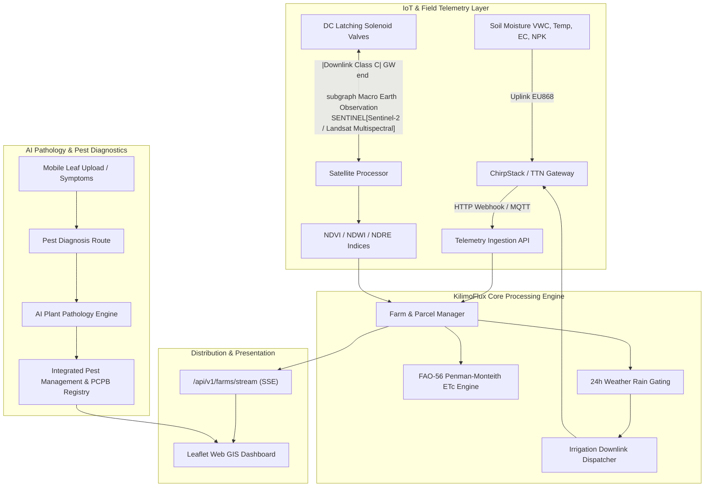

# Architecture — KilimoFlux

How **KilimoFlux** is engineered.

**Last reviewed:** 2026-10-05 by @jkose002

## Overview

KilimoFlux is an open-source smart agriculture platform that unifies **LoRaWAN IoT telemetry**, **Copernicus Sentinel-2 satellite remote sensing**, and **multimodal AI** to automate precision irrigation and diagnose crop pests and foliar diseases for Kenyan smallholders.

## System Diagram

## Module Map

| Path | Responsibility | Notes |
| :--- | :--- | :--- |
| `src/models/types.ts` | Data models & contracts | Farms, parcels, telemetry, satellite observations, recommendations |
| `src/iot/decoder.ts` | LoRaWAN uplink parsing | ChirpStack, TTN, and Dragino/Milesight binary decoding |
| `src/iot/downlink.ts` | Valve actuation downlink | Binary queue formatting for latching solenoid controllers |
| `src/satellite/indices.ts` | Spectral math | NDVI, NDWI, NDRE, canopy health and water stress classifications |
| `src/satellite/processor.ts` | Parcel satellite profiling | Sentinel-2 time series, cloud masking |
| `src/ai/fao-irrigation.ts` | Precision irrigation | FAO-56 Penman-Monteith $ET_0$, crop $K_c$, moisture deficit, rain gating |
| `src/ai/pest-diagnosis.ts` | Plant pathology AI | African crop disease recognition, IPM advice, PCPB catalog |
| `src/engine/farm-manager.ts` | Core state store | Seed farms (Kilifi, Naivasha, Eldoret), event emitter, telemetry store |
| `src/routes/` | REST APIs & SSE | Telemetry, irrigation, satellite, pest diagnosis, farms, health |
| `src/simulator/` | Multi-farm simulator | Emulates live soil sensors and automated valve cycles |
| `src/public/` | Web GIS Dashboard | Leaflet satellite map, real-time gauges, valve controls, diagnostic scanner |
| `tests/` | Automated test suite | Vitest unit and integration tests |

## Core Mathematical Formulations

### 1. Reference Evapotranspiration ($ET_0$)
Uses the FAO-56 Penman-Monteith approximation adapted for equatorial solar radiation and vapor-pressure deficit:
$$ET_0 = R_n \text{ (radiation equivalent)} + 0.012 (T + 5) u_2 \left(\frac{100 - RH}{100}\right)$$

### 2. Crop Evapotranspiration ($ET_c$)
$$ET_c = K_c \times ET_0$$
Where $K_c$ is calibrated across crop growth stages (`INITIAL`, `DEVELOPMENT`, `MID_SEASON`, `LATE_SEASON`).

### 3. Soil Moisture Deficit & Runtime
$$\text{Deficit (mm)} = Z_r \times (\theta_{\text{target}} - \theta_{\text{current}}) \times 10$$
$$\text{Runtime (min)} = \frac{\text{Deficit (mm)} \times 10{,}000 \times \text{Area (ha)}}{\text{FlowRate (L/min)} \times \eta_{\text{drip}}}$$

### 4. Satellite Canopy Indices
$$\text{NDVI} = \frac{B_{08} - B_{04}}{B_{08} + B_{04}}, \quad \text{NDWI} = \frac{B_{08} - B_{11}}{B_{08} + B_{11}}, \quad \text{NDRE} = \frac{B_{08} - B_{8A}}{B_{08} + B_{8A}}$$
